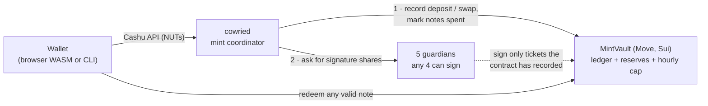

# Cowrie

[](https://github.com/bitccoli/cowrie/actions/workflows/ci.yml)
[](LICENSE)

### Signed by a federation. Kept by a contract.

Cowrie is an independent federated **Cashu** mint. A federation of guardians signs ecash with threshold BLS signatures, and a **Move smart contract on Sui** keeps the ledger and holds the reserves. Anyone can audit it, anyone can redeem, and only so much can leave each hour.

| | |
|---|---|
| **Live site** | https://cowrie-cashu.fly.dev |
| **Live playground** | https://cowrie-cashu.fly.dev/playground |
| **Demo video** | https://x.com/bitccoli/status/2126045660797706389 |
| **Pitch, comparison & Q&A** | [docs/pitch.md](docs/pitch.md) |
| **3-minute walkthrough** | [docs/hackathon-walkthrough.md](docs/hackathon-walkthrough.md) |

Built for Nut November 2026. Unaudited hackathon code.

---

## The idea in 30 seconds

1. **Today, every Cashu mint has a keeper.** One operator holds the key and the reserves. If they disappear, so do users' sats.
2. **Federated Cashu shares the key** among guardians, so no one can sign alone. But the guardians still have to agree on which notes were spent and still hold the reserves.
3. **Cowrie gives both jobs to a smart contract.** Guardians only sign. The contract records every spent note, holds the reserves in public, pays out any valid note by itself, and caps withdrawals per hour.

## How it works



| Role | Who | Does |
|---|---|---|
| **Signing** | 5 guardians, 4-of-5 threshold BLS12-381, dealer-free key generation | Sign blinded notes. Every share is pairing-checked, so a forged share is caught. |
| **Consensus** | `MintVault` Move contract | Records each spent note once (48-byte nullifiers), ordered by Sui. Guardians run no consensus. |
| **Custody** | `MintVault` Move contract | Holds reserves on-chain, verifies BLS notes itself and pays them out, trips an hourly melt cap. |

It works because **BLS signatures can be checked by anyone, including a smart contract**. A standard Cashu note (secp256k1) can only be checked by the mint that signed it.

The same `cowried` binary also runs **standalone on Lightning** (embedded engine + LNbits) without Sui.

## What to try (about 3 minutes)

Open the [playground](https://cowrie-cashu.fly.dev/playground). Guardians are drawn as lighthouses.

1. **Mint 16 × 1 sat.** Your browser blinds the notes in WASM, the federation signs, and the browser checks each signature offline before saving it. Secrets never leave the browser.
2. **Make a guardian lie:** click **False light** on Guardian 0, then mint again. Its forged share is caught (watch `caught` go up) and the other four still sign.
3. **Take one more down:** click **Dark** on Guardian 1. Only 3 of 5 are honest, so issuance halts safely: no bad notes. Set it back to **Lit**.
4. **Stream sats:** click **Stream 1 sat/s**. Each second the wallet pays 1 sat in an HTTP-402 `X-Cashu` header, verified offline. Then **Settle all in one batch**.
5. **Wipe & restore seed:** the wallet deletes its notes and recovers them from its seed.

> The playground is shared by everyone visiting. If a guardian is already dark or lying, set it back to **Lit**.

## How it compares

| | Single Cashu mint | Federated Cashu (typical) | **Cowrie** |
|---|---|---|---|
| Signing key | one operator | t-of-n guardians | 4-of-5 guardians |
| Who records spends | operator's database | guardians run consensus | **Move contract** |
| Where reserves sit | operator's Lightning node | the federation | **on-chain vault, public** |
| Redemption | operator must agree | federation must agree | **contract pays any valid note** |
| If key holders collude | everything lost | everything lost | **bounded by an hourly cap** |

## Numbers (`cowrie-bench --release`)

| | |
|---|---|
| Signature size | **48 B**, no DLEQ proof needed |
| 256-note token vs secp256k1 + DLEQ | **42.4 KB vs 62.9 KB** (32.6% smaller) |
| Verify one note offline | **1.21 ms** |
| Verify 256 notes in a batch (2 pairings) | **63.7 ms** (vs 306.7 ms one by one) |
| 4-of-5 sign + check every share + combine | **5.98 ms** |

A single secp256k1 check is faster than one BLS pairing; BLS wins on size, public verifiability and threshold signing.

## Run it locally

```bash
# mint + landing page + playground on http://127.0.0.1:3338 (playground at /playground)
cargo run -p cowrie-cashu-mintd --bin cowried -- --bind 127.0.0.1:3338 --data-dir ./cowrie-data

# terminal wallet
cargo run -p cowrie-cashu-mintd --bin cowrie-cli -- mint 64

# tests and benchmarks
cargo test --workspace
sui move test --path cashu/move/cowrie_cashu
cargo run --release -p cowrie-cashu-mintd --bin cowrie-bench
```

<details>
<summary>More: Sui vault, Lightning, key generation, Fedimint shim</summary>

```bash
# settle against the Move vault on a Sui localnet / testnet
./scripts/deploy-sui-localnet.sh
cargo run -p cowrie-cashu-mintd --bin cowried -- \
  --sui-rpc http://127.0.0.1:9000 \
  --blind-seal-package-id 0x... --cowrie-package-id 0x... \
  --vault-object-id 0x... --keyset-info-id 0x... \
  --sui-private-key suiprivkey1...

# standalone on Lightning via LNbits
cargo run -p cowrie-cashu-mintd --bin cowried -- --lnbits-url https://your-lnbits-host --lnbits-key YOUR_ADMIN_KEY

# dealer-free 2-round Pedersen key generation
cargo run -p blind-seal-server -- pedersen-dkg \
  --keyset-id 02_cowrie_sat --unit sat --threshold 4 --peers 5 --slots 32 --out-dir ./devnet-keys

# experimental Fedimint guardian shim on the same signing core
cargo run -p cowrie-fedimint-shim --bin cowrie-fedimintd -- --base-port 8173 --threshold 3 --peers 4

# all Move packages
sui move test --path blind-seal/move/blind_seal
sui move test --path fedimint/move/cowrie_fedimint
```
</details>

## Where to look in the code

| Path | What's there |
|---|---|
| [`cashu/move/cowrie_cashu/sources/mint_vault.move`](cashu/move/cowrie_cashu/sources/mint_vault.move) | **The vault:** spent-note table, reserves, on-chain BLS batch verification, hourly melt cap |
| [`blind-seal/move/blind_seal/sources/blind_seal.move`](blind-seal/move/blind_seal/sources/blind_seal.move) | Keysets and the signing tickets guardians check |
| [`blind-seal/crates/`](blind-seal/crates) | Threshold BLS12-381 signing, Pedersen DKG, guardian server, Sui client |
| [`cashu/crates/cowrie-cashu-mintd/src/lib.rs`](cashu/crates/cowrie-cashu-mintd/src/lib.rs) | The `cowried` mint and Cashu NUT API |
| [`cashu/crates/cowrie-cashu-mintd/assets/`](cashu/crates/cowrie-cashu-mintd/assets) | Landing page, playground and browser WASM |
| [`blind-seal/wasm/cowrie-bls-wasm/`](blind-seal/wasm/cowrie-bls-wasm) | Browser blinding and offline pairing checks |
| [`docs/federated-bls-spec-notes.md`](docs/federated-bls-spec-notes.md) | Pitfalls found building independently, proposed BLS keyset standard |

**Cashu NUTs supported:** 00 (V4 `cashuB`), 01–07, 09–14, 17 (WebSocket), 23 (`bolt11` + `sui`), 24 (HTTP-402).

## Honest limits

- Unaudited hackathon code.
- Current Cashu wallets only support secp256k1 keysets, so Cowrie ships its own browser and CLI wallets.
- In Sui mode, swaps and melts are public transactions. Issuance stays blinded, so deposits can't be linked to spends.
- Colluding guardians (4 of 5) could still sign unbacked notes; the hourly cap bounds the damage and every melt is visible on-chain.

MIT licensed.
