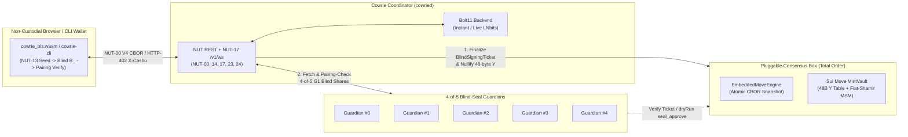

# Cowrie — Nut November Judge Walkthrough & Architecture Guide

This guide walks through **Cowrie**'s architecture, threshold `BLS12-381` (`min-sig`) protocol design, and a 3-minute hands-on verification flow.

---

## Architecture Overview



---

## 3-Minute Judge Walkthrough

### Step 1: Start `cowried` & Open the Non-Custodial WASM Playground
```bash
cargo run -p cowrie-cashu-mintd --bin cowried -- --bind 127.0.0.1:3338 --data-dir ./cowrie-data
```
Open `http://127.0.0.1:3338` in any modern browser:
1. **Non-Custodial Blinding & Pairing Verification:** Click **⚡ Mint 16x1 sat (BOLT11)**. Your browser derives `NUT-13` deterministic `(secret, r)` material locally, blinds `B_ = r * H_G1(secret)` inside `cowrie_bls.wasm`, collects the `4-of-5` threshold `BLS12-381` blind signature from `cowried`, unblinds `C`, and runs a full **offline bilinear pairing check** (`e(C, G2) == e(H_G1(secret), PK_G2)`) in WebAssembly before storing the proof in `localStorage`.
2. **Byzantine Guardian Chaos:** Click **Byzantine** on **Guardian #0** (causing it to return forged `G1` curve points). Mint or Swap again — watch Guardian #0's `Caught` counter increment as pairing share verification (`e(S'_i, G2) == e(B_, PK_i)`) rejects the bad share in real time while Guardians `{1, 2, 3, 4}` complete the `4-of-5` quorum seamlessly! Now set **Guardian #1** to **Offline** as well (`3` honest < `4` threshold) and confirm issuance halts safely. Restore Guardian #1 to **Healthy**.
3. **Zero-`DLEQ` Value4Value `HTTP-402` Streaming (`NUT-24`):** Click **▶ Start 1-sat/sec HTTP-402 Stream**. Every second, your browser packs a 1-sat `BLS12-381` proof into a binary `NUT-00` V4 CBOR `X-Cashu` header (**0 bytes of `NUT-12` `DLEQ` overhead!**), which the API verifies **offline in microseconds**. Click **📦 Batch-Melt All Buffered Sats** to settle all streamed notes in a single **128-bit Fiat-Shamir weighted multi-pairing** (`2` pairings total regardless of note count!).
4. **Wipe & Deterministic Seed Recovery (`NUT-13` + `NUT-09` + `NUT-07`):** Click **🌱 Wipe & Restore (NUT-13)**. The browser wipes its `localStorage` proofs (`0 sat`), re-derives deterministic `B_` outputs from its `NUT-13` seed, queries `POST /v1/restore` and `POST /v1/checkstate`, re-verifies pairings in WASM, and restores your exact unspent balance! Notice real-time `NUT-17` WebSocket (`/v1/ws`) push events streaming in the protocol log throughout.

### Step 2: Terminal CLI Wallet (`cowrie-cli`)
```bash
cargo run -p cowrie-cashu-mintd --bin cowrie-cli -- info
cargo run -p cowrie-cashu-mintd --bin cowrie-cli -- seed
cargo run -p cowrie-cashu-mintd --bin cowrie-cli -- mint 64
TOKEN=$(cargo run -q -p cowrie-cashu-mintd --bin cowrie-cli -- send 16)
cargo run -p cowrie-cashu-mintd --bin cowrie-cli -- receive "$TOKEN"
cargo run -p cowrie-cashu-mintd --bin cowrie-cli -- restore
```

### Step 3: Reproduce Quantitative Benchmarks & On-Chain Sui Move VM Tests

Measured with `cargo run --release -p cowrie-cashu-mintd --bin cowrie-bench`:

- **2-Round `4-of-5` Pedersen DKG (`32` slots):** `4.68 s`
- **Client `hash_to_g1` + Blinding (`B_`):** `124.7 µs`
- **`4-of-5` Sign + 4 Pairing Share Checks + Lagrange + Unblind:** `5.98 ms`
- **Single-Note Offline `NUT-24` Pairing Verify:** `1.21 ms`

| Batch Size (Notes) | Cowrie `cashuB` V4 Bytes (0B DLEQ) | `secp256k1` + `NUT-12` DLEQ `cashuB` Bytes | Token Size Savings | Naive Verify (`2N` Pairings) | Fiat-Shamir Batch Verify (`2` Pairings) | Speedup |
|---:|---:|---:|---:|---:|---:|---:|
| 1 | 234 B | 314 B | **25.5%** | 1.24 ms | **1.16 ms** | **1.1x** |
| 16 | 2,714 B | 3,994 B | **32.0%** | 19.48 ms | **5.11 ms** | **3.8x** |
| 64 | 10,652 B | 15,772 B | **32.5%** | 76.49 ms | **16.61 ms** | **4.6x** |
| 256 | 42,397 B | 62,877 B | **32.6%** | 306.70 ms | **63.69 ms** | **4.8x** |

```bash
# Release-mode BLS12-381 vs secp256k1+DLEQ payload & batch pairing benchmarks
cargo run --release -p cowrie-cashu-mintd --bin cowrie-bench

# Full Rust workspace tests (50-way swap race, Byzantine share rejection, Pedersen DKG, NUT-13/17, Fedimint WS)
cargo test --workspace

# Sui Move VM unit tests (including 120-bit Fiat-Shamir rogue-cancellation defense)
sui move test --path blind-seal/move/blind_seal
sui move test --path cashu/move/cowrie_cashu
sui move test --path fedimint/move/cowrie_fedimint
```
